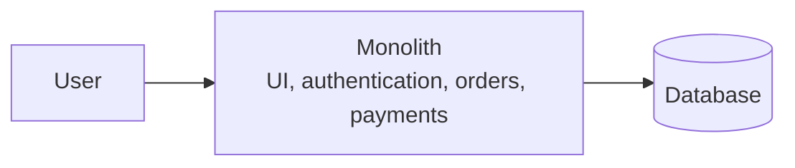

# Evolution of System Design

## What is it?

System design evolves as a product and its business needs change. A small application may start as one simple codebase. As traffic, teams, and features grow, the architecture may need to change so the system remains reliable and easy to develop.

There is no single "best" architecture. Each style solves a different set of problems and introduces new trade-offs.

## Why do we need it?

The architecture should support the current needs of the product:

- Deliver the first version quickly.
- Keep the code understandable as features grow.
- Scale the parts of the system that receive the most traffic.
- React to important actions quickly.
- Reduce the operational work owned by the application team.

Changing architecture too early can add unnecessary complexity. Keeping an old architecture for too long can make development and scaling difficult.

## How does it work?

### 1. Simple applications

Early software often focused on automating a task. A small team could keep most logic together because the product, traffic, and number of developers were limited.

### 2. Monolithic architecture

A monolith keeps the user interface, business logic, and data-access code in one deployable application. It commonly uses one main database.

Benefits:

- Simple to start, test, and deploy.
- One codebase is easier for a small team to understand.
- Low operational overhead.

Challenges as the product grows:

- A change in one area can affect the whole application.
- Teams may block one another when working in the same codebase.
- The whole application may need to scale even when only one feature is busy.

### 3. Microservices

Microservices split a system into smaller services, each responsible for a clear business capability, such as orders or payments. Services can be developed, deployed, and scaled independently when that independence is valuable.

Benefits:

- Teams can work on separate services more independently.
- A busy service can scale without scaling every component.

Costs:

- Network communication, monitoring, deployment, and failure handling become harder.
- Data ownership and consistency across services require careful design.

### 4. Event-driven architecture

In an event-driven system, one component records that something happened—such as `OrderPlaced`—and other components react to that event. A message broker or event stream often delivers the event asynchronously.

This is useful for work such as sending notifications, updating analytics, or starting delivery workflows. It can improve responsiveness and decouple services, but it also requires handling duplicate events, delayed processing, and eventual consistency. Event-driven systems do not automatically eliminate every form of polling.

### 5. Serverless architecture

Serverless platforms run application code on managed infrastructure, often as functions triggered by HTTP requests, events, or schedules. The cloud provider manages much of the server provisioning and scaling.

Benefits:

- Less infrastructure management for the team.
- Useful for variable or event-based workloads.

Costs:

- Execution limits, startup delay in some platforms, and provider-specific design constraints.
- Observability and local testing can be more difficult.

## Example

An online store may begin as a monolith because one team can ship features quickly. As payment traffic grows, the team might extract a payment service so it can scale and be secured separately. When an order is placed, the order service can publish an event that triggers inventory updates and customer notifications without making the customer wait for every background task.

## Important Points

- Architecture should follow real product needs, not trends.
- A monolith is often a sensible starting point.
- Microservices add independence, but also operational complexity.
- Events help systems react asynchronously to important actions.
- Serverless reduces infrastructure work but does not remove design trade-offs.
- Prefer the simplest architecture that satisfies the current requirements.

## Interview Questions

### Why not start with microservices?

Microservices require service discovery, network communication, monitoring, deployment automation, and distributed data handling. A small product may not need that complexity yet.

### When is event-driven architecture useful?

It is useful when one action should trigger independent background work, such as sending a receipt after a payment or updating recommendations after a user watches a video.

### Does serverless mean there are no servers?

No. Servers still run the code, but the cloud provider manages most of the infrastructure work.

## Recap

System design changes as business needs change: simple applications often become monoliths, and growing needs may introduce services, events, or serverless platforms. Choose each step because it solves a real problem and understand the complexity it adds.
