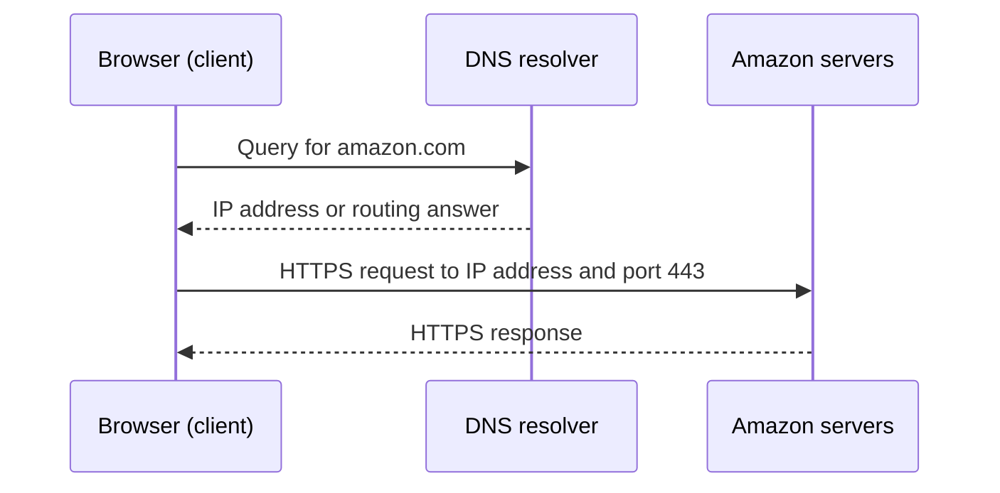

# Client-Server Architecture

## What is it?

Client-server architecture is a model in which a **client** asks for a service and a **server** provides it. The client can be a browser, mobile app, desktop application, or IoT device. The server can provide web pages, APIs, payments, storage, or other processing.

Most internet applications use this model, although a real service usually has many servers rather than one machine.

## Why do we need it?

It separates the user-facing application from the systems that store data and perform shared work. A browser, for example, does not need to know how an e-commerce company stores products or processes payments; it only needs to send requests to the service's public interface.

## How does it work?

When a user opens `amazon.com`, the browser follows a request-and-response flow:

1. The client needs an address for the server. It uses the Domain Name System (DNS) to look up how to reach a domain name such as `amazon.com`.
2. DNS returns an answer, often an IP address. An **IP address** identifies a network interface that can be reached on an IP network.
3. The browser opens a network connection and sends an HTTP request. In normal production use, this is HTTPS, which is HTTP protected by TLS.
4. The server receives the request, performs work such as reading data or processing a payment, and sends a response back to the client.

### IP addresses and ports

An IP address is like a building address. A **port** is like an apartment number: it identifies the specific network service on that address. A server program listens on a port for a protocol such as TCP or UDP.

Port numbers are 16-bit values, so TCP and UDP each use port numbers from 0 through 65,535. Common web ports are 80 for HTTP and 443 for HTTPS. The client also uses its own temporary source port, which helps the operating system send the response to the right application.

## Example

In a food-delivery app, the mobile app is the client. When a user views nearby restaurants, it sends a request to the server. The server reads restaurant data, applies the user's location and filters, and returns a response for the app to display.

## Important Points

- A client requests a service; a server provides a service.
- DNS helps clients find where a domain can be reached.
- HTTP/HTTPS carries application requests and responses.
- An IP address identifies a reachable network interface; a port identifies a service on it.
- One public product can use many servers behind a single domain name.
- Client-server does not mean the client must directly know the server's internal implementation.

## Interview Questions

### What happens after a user enters a URL in a browser?

The browser resolves the domain with DNS, connects to the selected server address and port, establishes security for HTTPS, sends an HTTP request, and renders the response it receives.

### What is the difference between an IP address and a port?

An IP address identifies a network destination. A port identifies a particular application or service at that destination.

### Can a client also be a server?

Yes. The terms describe roles in a particular interaction. A service can be a client when it calls another service, and a device can provide services to other devices.

## Recap

Client-server architecture powers most internet applications. Clients discover and contact servers through networking layers such as DNS, IP, ports, and HTTP/HTTPS; servers process requests and return responses.
